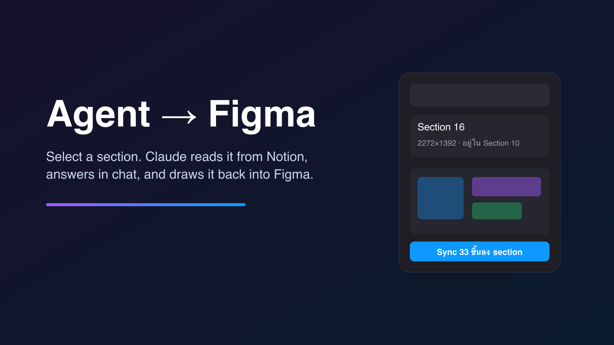

# 🤖 Agent to Figma

<div align="center">


### Select a Section in Figma, let Claude read it from Notion, and draw the answer back in.

[](https://www.figma.com/community)
[](https://claude.ai)
[](LICENSE)

<br/>



</div>

---

## 📖 Overview

**Agent to Figma** is the reverse of [figma-to-notion](https://github.com/Tapakorn086/figma-to-notion). You select a Section or Frame in Figma, and Claude:

1. Reads its structure and image through a local bridge
2. Finds the matching row in your Notion database by Figma key
3. Answers in chat, or writes drawing instructions (ops)
4. Previews them in the plugin. **You press Sync** to draw into the selected Section.

Claude never draws without your Sync. Every drawn piece stays inside the Section, and Sync can be undone.

---

## ✨ Features

- **Read a section:** outline (Markdown or JSON) and a PNG of the section, ready to paste or sent over the bridge
- **Draw into a section:** `frame`, `rect`, `ellipse`, `text`, `line`, with auto layout on frames
- **Preview before drawing:** every op is checked against the section size, and mistakes are listed before Sync
- **Undo:** remove the last Sync, or clear everything the agent drew
- **Parent context:** shows which Sections contain the selected one, and their Figma keys for matching Notion

---

## 🚀 Setup

### 1. Install the plugin

Figma desktop → **Plugins → Development → Import plugin from manifest…** → select `manifest.json`

### 2. Start the bridge

```bash
cd ~/Documents/agent-to-figma && node bridge.js
```

The bridge listens on `http://localhost:4848` (127.0.0.1 only).

### 3. Use it

1. Select one Section or Frame on the canvas
2. Open **Agent to Figma** and check that the status shows **Claude ออนไลน์** (green)
3. In chat, tell Claude what to read or draw, for example: *"ช่วยอ่าน section ที่ฉันเลือกใน Figma แล้วไปดู row ของมันใน Notion จากนั้นตอบฉันในแชตนี้"*

The plugin has a "วิธีใช้" card with the bridge command and this prompt, each with a copy button.

---

## 🔌 Bridge endpoints

| Endpoint | Purpose |
|---|---|
| `GET /status` | Is the plugin online, which section is selected, latest preview/sync results |
| `POST /read` then `GET /context` | Ask the plugin to read the selected section (Markdown/JSON) |
| `GET /context.png` | PNG of the last read section |
| `POST /ops` `{ "ops": [...], "note": "..." }` | Send drawing ops. The plugin previews them; you press Sync. |

---

## 🧩 Ops format

```json
{
  "note": "Summary of Section 10",
  "ops": [
    { "op": "text", "text": "Checkout flow", "fontSize": 28, "bold": true },
    { "op": "frame", "id": "card", "x": 24, "y": 80, "w": 320, "h": 200, "fill": "#FFFFFF", "stroke": "#DDDDDD", "radius": 12, "layout": "vertical" },
    { "op": "text", "parent": "card", "text": "Step 1: enter address", "w": 280 },
    { "op": "rect", "x": 380, "y": 80, "w": 160, "h": 48, "fill": "#0D99FF", "radius": 8 },
    { "op": "line", "x": 344, "y": 104, "w": 36 }
  ]
}
```

| Op | Fields |
|---|---|
| All | `x`, `y` (from the section's top-left), `w`, `h`, `name`, `fill`, `stroke` (hex), `id`, `parent` |
| `frame` | `radius`, `layout`: `vertical` / `horizontal` (auto layout) |
| `rect` | `radius` |
| `ellipse` | — |
| `text` | `text` (required), `fontSize` (16), `bold`, `w` (wraps to width) |
| `line` | `w` = length |

Rules:

- Omit `y` and the op stacks below the previous top-level op (24px gap)
- `parent` must point to an earlier `frame` with an `id`
- Ops that fall outside the section are rejected at Preview
- If any op fails to draw, the whole batch is rolled back
- Text uses Inter

---

## 🛠 Development

```bash
npm test
```

Tests cover the pure logic in `/* domain:start */` … `/* domain:end */` regions of `code.js` and `ui.html`. There is no build step. Re-run the plugin in Figma after editing.

---

## 📄 License

MIT. See [LICENSE](LICENSE).
