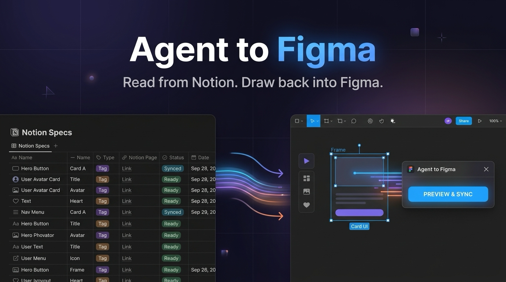

# 🤖 Agent to Figma

<div align="center">


### Select a Section in Figma, let Claude read it from Notion, and draw the answer back in.

[](https://www.figma.com/community)
[](https://claude.ai)
[](LICENSE)

<br/>



</div>

---

## 📖 Overview

**Agent to Figma** is the companion & reverse workflow of [figma-to-notion](https://github.com/Tapakorn086/figma-to-notion). Together, they form a complete two-way loop between your design canvas and your documentation:

- **[figma-to-notion](https://github.com/Tapakorn086/figma-to-notion)** — **Figma → Notion:** Export layers, frames, tables, and specs from Figma into your Notion database.
- **Agent to Figma (this repo)** — **Notion → Figma:** Let Claude read your selected Figma Section, look up its matching row in Notion, and draw the answer or new components back into Figma.

Claude never draws without your **Sync**. Every drawn piece stays inside the selected Section, and every Sync can be undone.

Perfect for:
- 🤖 **Design-to-Agent Context:** Send a Section's outline and PNG directly to Claude so it understands your layout and Notion specs.
- ✏️ **Agent-to-Canvas Drawing:** Let Claude propose frames, cards, shapes, and text back into Figma.
- 🛡️ **Safe, Previewed Sync:** Inspect every op and bounding-box check before anything is drawn on your canvas.

---

## ✨ Features

- **Read a Section:** Exports the selected Section's outline (Markdown or JSON) and a PNG render, ready to paste or send over the local bridge.
- **Draw into a Section:** Supports `frame`, `rect`, `ellipse`, `text`, and `line`, with auto layout on frames.
- **Preview Before Drawing:** Every op is checked against the Section size, and any mistakes are listed before you press **Sync**.
- **Undo & Clear:** Remove the last Sync, or clear everything the agent drew in one click.
- **Parent Context:** Shows which parent Sections contain the selected one, along with their Figma keys for matching Notion rows.

---

## 🚀 Installation & Local Development

### 1. Install the Plugin

1. Clone this repository:
   ```bash
   git clone https://github.com/Tapakorn086/agent-to-figma.git
   cd agent-to-figma
   ```
2. Open **Figma Desktop**.
3. Navigate to: `Plugins` > `Development` > `Import plugin from manifest...`
4. Select the [`manifest.json`](manifest.json) file in this repository.
5. The plugin is now ready under `Plugins` > `Development` > **Agent to Figma**.

### 2. Start the Bridge

```bash
cd ~/Documents/agent-to-figma && node bridge.js
```

The bridge listens on `http://localhost:4848` (`127.0.0.1` only).

---

## 💡 How to Use

1. Select one **Section** or **Frame** on your Figma canvas.
2. Run the **Agent to Figma** plugin and check that the status shows **Claude ออนไลน์** (green).
3. In chat, tell Claude what to read or draw, for example:
   *"ช่วยอ่าน section ที่ฉันเลือกใน Figma แล้วไปดู row ของมันใน Notion จากนั้นตอบฉันในแชตนี้"*
4. Review the previewed ops in the plugin, then click **Sync** to draw them into the selected Section.

> 💡 **Tip:** The plugin includes a **"วิธีใช้"** card with the bridge command and sample prompt, each with a one-click copy button.

---

## 🔌 Bridge endpoints

| Endpoint | Purpose |
|---|---|
| `GET /status` | Is the plugin online, which section is selected, latest preview/sync results |
| `POST /read` then `GET /context` | Ask the plugin to read the selected section (Markdown/JSON) |
| `GET /context.png` | PNG of the last read section |
| `POST /ops` `{ "ops": [...], "note": "..." }` | Send drawing ops. The plugin previews them; you press Sync. |

---

## 🧩 Ops format

```json
{
  "note": "Summary of Section 10",
  "ops": [
    { "op": "text", "text": "Checkout flow", "fontSize": 28, "bold": true },
    { "op": "frame", "id": "card", "x": 24, "y": 80, "w": 320, "h": 200, "fill": "#FFFFFF", "stroke": "#DDDDDD", "radius": 12, "layout": "vertical" },
    { "op": "text", "parent": "card", "text": "Step 1: enter address", "w": 280 },
    { "op": "rect", "x": 380, "y": 80, "w": 160, "h": 48, "fill": "#0D99FF", "radius": 8 },
    { "op": "line", "x": 344, "y": 104, "w": 36 }
  ]
}
```

| Op | Fields |
|---|---|
| All | `x`, `y` (from the section's top-left), `w`, `h`, `name`, `fill`, `stroke` (hex), `id`, `parent` |
| `frame` | `radius`, `layout`: `vertical` / `horizontal` (auto layout) |
| `rect` | `radius` |
| `ellipse` | — |
| `text` | `text` (required), `fontSize` (16), `bold`, `w` (wraps to width) |
| `line` | `w` = length |

Rules:

- Omit `y` and the op stacks below the previous top-level op (24px gap)
- `parent` must point to an earlier `frame` with an `id`
- Ops that fall outside the section are rejected at Preview
- If any op fails to draw, the whole batch is rolled back
- Text uses Inter

---

## 🛠 Development

```bash
npm test
```

Tests cover the pure logic in `/* domain:start */` … `/* domain:end */` regions of `code.js` and `ui.html`. There is no build step. Re-run the plugin in Figma after editing.

---

## 🔒 Security & Privacy

- **Local-Only Bridge:** `bridge.js` binds strictly to `127.0.0.1:4848`—no external server or third-party backend is involved.
- **Explicit Sync Gate:** Claude can only queue ops for preview; nothing is drawn on your canvas until you click **Sync**.

---

## 📄 License

This project is licensed under the [MIT License](LICENSE).
